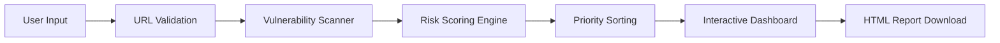
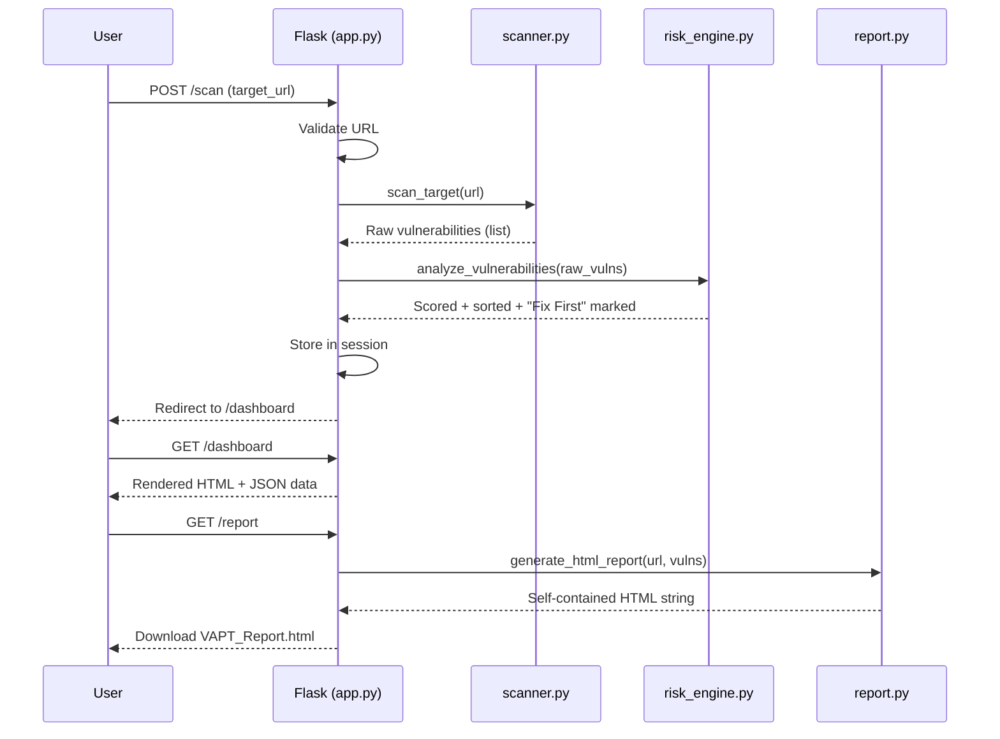

# Automated VAPT Framework with Risk-Based Prioritization and Interactive Dashboard

## 1. Project Overview

**Title:** Automated VAPT Framework with Risk-Based Prioritization and Interactive Dashboard

**Objective:** Build a complete, demo-ready prototype that demonstrates an end-to-end vulnerability assessment pipeline: **Input → Scan → Risk Scoring → Dashboard → Report**

**Tech Stack:** Python (Flask) · HTML/CSS/JS · Chart.js

**Pipeline Flow:**


---

## 2. Project Structure

```
SS Project/
├── app.py                    # Flask application — routes & orchestration
├── utils/
│   ├── __init__.py           # Package initializer
│   ├── scanner.py            # Simulated vulnerability scanner
│   ├── risk_engine.py        # Risk scoring engine (core feature)
│   └── report.py             # Downloadable HTML report generator
├── templates/
│   ├── index.html            # Landing page — URL input form
│   └── dashboard.html        # Dashboard — charts, table, attack demo
└── static/
    ├── style.css             # Dark-themed UI with glassmorphism
    └── script.js             # Chart.js rendering & form validation
```

---

## 3. Setup & Execution

```bash
pip install flask
python app.py
```
Open **http://127.0.0.1:5000** in your browser.

---

## 4. Module-by-Module Implementation

---

### 4.1 Main Application — [app.py](file:///c:/Users/tanma/Downloads/SS%20Project/app.py)

The Flask server that wires everything together. Contains 5 routes:

| Route | Method | Purpose |
|---|---|---|
| `/` | GET | Landing page with URL input form |
| `/scan` | POST | Validates URL, runs scanner, computes risk scores, stores results in session, redirects to dashboard |
| `/dashboard` | GET | Renders interactive dashboard with charts and vulnerability table |
| `/api/results` | GET | Returns scan results as JSON (API endpoint) |
| `/report` | GET | Generates and serves downloadable HTML report |

**Key Logic in `/scan` route:**
```python
# Step 1: Validate URL (regex pattern matching)
# Step 2: Run simulated scanner
raw_vulnerabilities = scan_target(target_url)
# Step 3: Analyze through risk engine
analyzed_vulnerabilities = analyze_vulnerabilities(raw_vulnerabilities)
# Step 4: Store in Flask session → redirect to /dashboard
```

**URL Validation** uses regex to accept formats like `https://example.com`, `example.com`, `http://site.org:8080/path`.

---

### 4.2 Vulnerability Scanner — [scanner.py](file:///c:/Users/tanma/Downloads/SS%20Project/utils/scanner.py)

Simulates real-world vulnerability scanning using a **pre-built vulnerability database** of 6 entries.

**Vulnerability Database:**

| # | Type | Severity | Endpoint | Payload Example |
|---|---|---|---|---|
| 1 | SQL Injection | High | `/login` | `' OR 1=1 --` |
| 2 | SQL Injection | High | `/admin/users` | `' UNION SELECT username, password FROM users --` |
| 3 | XSS | Medium | `/search` | `<script>alert('XSS')</script>` |
| 4 | XSS | Medium | `/comments` | `` |
| 5 | SQL Injection | High | `/api/products` | `1; DROP TABLE products --` |
| 6 | XSS | Low | `/profile` | `<svg onload=alert('XSS')>` |

**Scanning Logic:**
- Always returns the first 3 core vulnerabilities (for consistent demo)
- Randomly adds 1–3 extra vulnerabilities from entries 4–6 (for variety)
- Tags each result with the target URL

**Return Format:**
```json
[
  { "type": "SQL Injection", "severity": "High", "endpoint": "/login", "description": "...", "payload_example": "' OR 1=1 --" }
]
```

---

### 4.3 Risk Scoring Engine — [risk_engine.py](file:///c:/Users/tanma/Downloads/SS%20Project/utils/risk_engine.py)

> [!IMPORTANT]
> This is the **core feature** of the project — the differentiating factor that makes it more than just a scanner.

#### Risk Score Formula

```
Risk Score = Exploitability × Impact × Exposure
```

Each factor is rated on a **1–5 scale**. Maximum possible score = 5 × 5 × 5 = **125**.

#### Risk Factor Assignments

| Vulnerability | Exploitability | Impact | Exposure | **Score** |
|---|:---:|:---:|:---:|:---:|
| SQL Injection | 5 (automated tools available) | 5 (full DB compromise) | 4 (common in web forms) | **100** |
| XSS | 4 (requires user interaction) | 3 (session hijacking) | 3 (depends on validation) | **36** |

#### Priority Classification

| Score Range | Priority | Action |
|---|---|---|
| ≥ 80 | **High** | Fix immediately |
| 40 – 79 | **Medium** | Schedule fix |
| < 40 | **Low** | Monitor and plan |

#### Processing Pipeline (`analyze_vulnerabilities` function):
1. For each vulnerability → compute risk score using the formula
2. Attach mitigation recommendation
3. Sort all results by score **(descending)**
4. Mark the top item as **"Fix First"**

#### Mitigation Mapping

| Vulnerability | Primary Mitigation | Detailed Steps |
|---|---|---|
| SQL Injection | Prepared statements / parameterized queries | Use parameterized queries, implement ORM, input validation, stored procedures, least-privilege DB accounts |
| XSS | Output encoding / input sanitization | Context-aware encoding, CSP headers, DOMPurify, server-side validation, HTTPOnly cookies |

---

### 4.4 Report Generator — [report.py](file:///c:/Users/tanma/Downloads/SS%20Project/utils/report.py)

Generates a **self-contained, downloadable HTML file** with all CSS inline (no external dependencies).

**Report Contents:**
- Scan metadata (target URL, timestamp)
- Summary statistics (total, high/medium/low counts)
- **Fix First recommendation** prominently displayed
- Vulnerability table with risk scores, priorities, and descriptions
- Detailed risk factor breakdown per vulnerability
- Mitigation steps for each finding
- Print-friendly styles (`@media print` rules)

---

### 4.5 Landing Page — [index.html](file:///c:/Users/tanma/Downloads/SS%20Project/templates/index.html)

**Sections:**
1. **Header** — SVG shield logo + gradient title "VAPT Framework"
2. **Scan Card** — URL input form with validation, error alerts, "Initiate Scan" button with loading animation
3. **Pipeline Steps** — Visual 4-step flow: Input → Scan → Analyze → Report
4. **Feature Cards** — 3-card grid: Vulnerability Detection, Risk Scoring, Report Generation

---

### 4.6 Dashboard — [dashboard.html](file:///c:/Users/tanma/Downloads/SS%20Project/templates/dashboard.html)

**Sections:**

| Section | Description |
|---|---|
| **Nav Bar** | Sticky top bar with logo, "New Scan" link, "Download Report" button |
| **Stats Grid** | 4 cards: Total, High Priority, Medium Priority, Low Priority (animated counters) |
| **Fix First Alert** | Highlighted banner with pulsing border showing the highest-risk vulnerability |
| **Charts** | Doughnut chart (severity distribution) + horizontal bar chart (risk scores) |
| **Vulnerability Table** | Sortable table: #, Type, Endpoint, Severity, Risk Score (with visual bar), Priority, Mitigation |
| **Formula Card** | Explains the risk scoring formula with worked examples for SQLi and XSS |
| **Attack Simulation** | Static demo of SQL Injection (`' OR 1=1 --`) and XSS (`<script>alert('XSS')</script>`) payloads with how-they-work explanations |

---

### 4.7 Styling — [style.css](file:///c:/Users/tanma/Downloads/SS%20Project/static/style.css)

**Design System:**
- Dark theme (`#0a0e1a` background)
- Glassmorphism cards with `backdrop-filter: blur(20px)`
- CSS custom properties for colors, spacing, border-radius
- Gradient accents (indigo `#818cf8` → purple `#c084fc`)
- Priority color coding: Red (high), Amber (medium), Green (low)
- Animated background grid + floating glow orbs
- Responsive breakpoint at 768px

---

### 4.8 Frontend Logic — [script.js](file:///c:/Users/tanma/Downloads/SS%20Project/static/script.js)

| Function | Purpose |
|---|---|
| Form submit handler | Client-side URL validation + loading spinner |
| `renderSeverityPieChart()` | Chart.js doughnut chart — High/Medium/Low severity counts |
| `renderRiskBarChart()` | Chart.js horizontal bar chart — risk scores per vulnerability, color-coded by priority |
| `animateStatCards()` | Counter animation on dashboard stat cards |
| Score-fill initializer | Reads `data-score` attributes and sets progress bar widths |

---

## 5. Data Flow Diagram



---

## 6. Sample Output

When scanning `https://example.com`, the system produces:

| # | Type | Endpoint | Severity | Risk Score | Priority |
|---|---|---|---|---|---|
| 1 | SQL Injection | /login | High | **100** | **High** ⚠ FIX FIRST |
| 2 | SQL Injection | /admin/users | High | **100** | High |
| 3 | XSS | /search | Medium | **36** | Low |
| 4 | XSS | /comments | Medium | **36** | Low |
| 5 | XSS | /profile | Low | **36** | Low |

**Fix First Recommendation:** SQL Injection at `/login` — Use prepared statements / parameterized queries.

---

## 7. Viva Preparation Guide

### Q1: Explain the system workflow step-by-step.

> 1. User enters a target URL on the landing page
> 2. The server validates the URL format (client-side + server-side)
> 3. The simulated scanner checks the target against a vulnerability database
> 4. Each detected vulnerability is scored using: **Risk Score = Exploitability × Impact × Exposure**
> 5. Results are sorted by score (highest first) and the top item is marked "Fix First"
> 6. The dashboard displays an interactive table, pie chart (severity), and bar chart (risk scores)
> 7. The user can download a self-contained HTML report with all findings and mitigations

### Q2: Why is automation used instead of manual testing?

> - **Speed:** Automated scans complete in seconds vs. hours of manual testing
> - **Consistency:** Every scan follows the same methodology — no human error or oversight
> - **Scalability:** Can scan hundreds of endpoints systematically
> - **Prioritization:** Mathematical risk scoring removes subjective bias
> - **Reproducibility:** Results are deterministic and auditable

### Q3: Why were SQL Injection and XSS selected?

> - They are the **top 2 most common** web application vulnerabilities per OWASP Top 10
> - **SQL Injection** represents *server-side* attacks (database compromise, data theft)
> - **XSS** represents *client-side* attacks (session hijacking, credential theft)
> - Together they cover both major attack surfaces of web applications
> - They have clear, well-understood mitigation strategies

### Q4: Why is risk scoring important?

> - Not all vulnerabilities are equally dangerous — a SQLi on `/login` is far more critical than a low-impact XSS on `/profile`
> - Organizations have **limited resources** — risk scoring enables **triage** (fix worst first)
> - The "Fix First" recommendation gives **actionable** guidance
> - Based on industry frameworks like **CVSS** and **DREAD**
> - Converts subjective severity labels into **quantitative, comparable scores**

### Q5: What are the limitations?

> | Limitation | Explanation |
> |---|---|
> | Simulated data | Uses pre-defined database, not real network scanning |
> | Limited vulnerability types | Only SQLi and XSS (production tools cover 100+ types) |
> | No authentication testing | Doesn't test login bypass, session management, CSRF |
> | No false-positive detection | Real scanners must verify findings to reduce noise |
> | Static risk factors | Real scoring should consider environment-specific context |
> | Single-target only | No support for batch/network-wide scanning |
> | No remediation verification | Cannot confirm if fixes were properly applied |

---

## 8. Key Design Decisions

| Decision | Rationale |
|---|---|
| Simulated scanner | Ensures 100% reliable demos — no network dependencies or timeouts |
| Flask sessions for state | Simple, no database needed — keeps setup to `pip install flask` |
| Self-contained HTML report | Report works offline with no external dependencies |
| Chart.js via CDN | Lightweight, no build step, widely supported |
| Dark glassmorphism UI | Modern, premium look suitable for college presentations |
| Modular `utils/` package | Clean separation of concerns — scanner, engine, report are independent |

---

## 9. Future Enhancements (If Asked)

- Integrate real scanners (Nmap, OWASP ZAP) via subprocess calls
- Add more vulnerability types (CSRF, SSRF, IDOR, broken authentication)
- Implement CVSS v3.1 scoring for industry-standard risk assessment
- Add user authentication and scan history database
- Export reports in PDF format
- Implement real-time scanning with WebSocket progress updates
- Add remediation verification (re-scan after fix)
